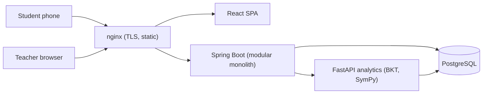

# Spec: Grade 9 Algebra Diagnostic Platform — V1

Status: **draft — awaiting review**
Intent: [docs/intent/grade9-algebra-diagnostic.md](docs/intent/grade9-algebra-diagnostic.md)

---

## 0. Assumptions (correct these before approving)

1. **UI language is Vietnamese only**. Code, identifiers and docs are in English.
2. **Students do not have email addresses.** Accounts are created in bulk from the class roster (Excel). Login is `username + password`, and teachers can reset student passwords.
3. **Curriculum = Chương trình GDPT 2018, Toán 9.** In this program, "Hàm số bậc nhất" belongs to Grade 8. The poster's "Hàm số bậc nhất" node will be treated as a **prerequisite skill**, not a Grade 9 topic (see Open Question Q1).
4. **One school, one academic year** in V1. The data model still contains `school` and `grade` so later expansion needs no rewrite.
5. **Hosting:** one VPS in Vietnam (about 4 vCPU, 8 GB RAM, 80 GB SSD) running Docker Compose. Domain and TLS come from Let's Encrypt.
6. **Auth:** Spring Security with a server-side session in an HttpOnly cookie, so there are no JWT refresh complexities for a junior team.
7. **Personal data of minors** falls under **Nghị định 13/2023/NĐ-CP** (Vietnam's personal data protection decree). The school gets parental consent through its normal channel, and the platform stores the minimum data needed.

---

## 1. Objective

Help Grade 9 math teachers find out **every week, which students are not progressing in Algebra, why, and what to do**. The platform turns students' practice and existing scores into explainable diagnoses and targeted practice.

### Users & roles

| Role | Who | Main device | Core needs |
|---|---|---|---|
| `STUDENT` | ~500–600 Grade 9 students | Android phone, evening, 4G | Do assigned and recommended practice, see their own progress |
| `TEACHER` | Math teachers of 10–13 classes | Laptop/desktop | Weekly at-risk list, the reasons behind each flag, assigning practice, logging interventions |
| `CONTENT_ADMIN` | 2 math teachers (may also be `TEACHER`) | Desktop | Manage the skill map, questions and error types (*dạng lỗi sai*) |
| `SYS_ADMIN` | Dev team / school IT | Desktop | Rosters, accounts, imports, backups |

### Key user stories (V1)

**Student**
- S1. As a student, I log in on my phone and see **"Việc cần làm hôm nay"** (today's to-do): assigned quizzes plus up to 3 recommended practice sets.
- S2. I answer multiple-choice, numeric and algebraic-expression questions with a math keyboard. Formulas display correctly.
- S3. After each question or set I see whether I was right, the correct solution, and **what kind of mistake I made** when it was detected.
- S4. I see my skill map (*bản đồ kiến thức*) in 4 mastery levels and my weekly streak.

**Teacher**
- T1. Every Monday I open a class and see **students sorted by risk** (Thấp / Trung bình / Cao: low / medium / high), each with **1–3 plain-language reasons** (e.g. "Yếu kỹ năng *Giải PT bậc hai bằng công thức nghiệm* — nguyên nhân gốc: *Tính Δ*; 3 tuần không luyện tập" = weak at solving quadratics with the formula, root cause computing Δ, no practice for 3 weeks).
- T2. I see the class **skill-gap heatmap** (*heatmap lỗ hổng kỹ năng*: students × skills) and the **top error types** with percentages.
- T3. With one click I assign the suggested practice set to one student, a group or the whole class.
- T4. I log an intervention ("đã gặp riêng", "giao bài bổ trợ", "báo GVCN": met privately, assigned remedial work, informed the homeroom teacher) so its effect can be measured.
- T5. I import scores (Excel template / VnEdu-SMAS export / paper tests) and map columns to tests and topics.
- T6. I enter or import mock-exam (*thi thử*) Algebra scores, including per-question/per-topic points when available.

**Content admin**
- C1. I manage the **skill graph**: chapters → skills, with prerequisite links.
- C2. I create questions in a form with LaTeX preview, or **bulk import from an Excel template**. Each question is tagged with 1–3 skills, a difficulty (1–3) and a worked solution.
- C3. I define **error types** and attach them to MCQ distractors, or to **wrong-answer rules** for numeric/expression questions (e.g. answer `= −x₀` → "Sai dấu khi chuyển vế", a sign error when moving terms across the equals sign).
- C4. I review questions flagged by the system (too easy/hard, suspicious distractors).

---

## 2. Capability map (modules)

This request bundles several capabilities that can be tested separately, so each module below gets its own `SPEC-<module-id>.md` after this top-level spec is approved.

| Module id | Responsibility | Depends on |
|---|---|---|
| `identity-roster` | Accounts, roles, login, school/year/class/enrollment, roster import | — |
| `content-bank` | Skill graph, questions, error types, wrong-answer rules, Excel import | identity-roster |
| `practice` | Assignments, quiz delivery, answer checking, response logging, error detection | content-bank |
| `score-import` | External/paper/mock-exam scores, column mapping, topic linking | identity-roster, content-bank |
| `diagnosis-engine` | Mastery (BKT), root-cause analysis, behavior signals, risk score, recommendations | practice, score-import |
| `teacher-dashboard` | Class overview, heatmap, risk list, error stats, assign, intervention log | diagnosis-engine |
| `student-home` | To-do, skill map, progress, streak | practice, diagnosis-engine |
| `platform-ops` | Deployment, backups, monitoring, analytics export for the evaluation | all |

**Build order:** `identity-roster` → `content-bank` → `practice` → `score-import` ∥ `diagnosis-engine` (v0 rules) → `student-home` ∥ `teacher-dashboard` → `diagnosis-engine` (BKT) → `platform-ops` hardening.

> Reason for this order: the teachers need `content-bank` **by about week 4** so they can start writing 300–500 questions while the devs build practice and the dashboards.

---

## 3. Functional requirements

### 3.1 Algebra skill scope (draft, for the 2 teachers to finalize)

| Chapter (GDPT 2018, Toán 9) | Example skills |
|---|---|
| Phương trình & hệ hai PT bậc nhất hai ẩn (linear systems in two unknowns) | Nhận biết nghiệm; giải hệ bằng PP thế; PP cộng đại số; giải bài toán bằng cách lập hệ |
| Phương trình & bất phương trình bậc nhất một ẩn (linear equations/inequalities in one unknown) | PT tích; PT chứa ẩn ở mẫu (ĐKXĐ); giải BPT; biểu diễn tập nghiệm |
| Căn bậc hai & căn bậc ba (square and cube roots) | ĐK xác định căn; khai phương tích/thương; đưa thừa số ra/vào dấu căn; trục căn thức; rút gọn biểu thức chứa căn |
| Hàm số y = ax² (a ≠ 0) | Tính giá trị; vẽ đồ thị; tương giao parabol–đường thẳng |
| Phương trình bậc hai một ẩn (quadratic equations) | Tính Δ / Δ′; công thức nghiệm; định lý Vi-ét; tìm m thỏa điều kiện; lập PT bài toán thực tế |
| Prerequisites (Grade 8) | Hằng đẳng thức; phân tích đa thức thành nhân tử; hàm số bậc nhất; quy tắc chuyển vế |

Target: **25–40 skills, 300–500 questions**, at least 8 questions per skill across 3 difficulty levels, before go-live.

### 3.2 Question types (V1)

| Type | Answer check | Error detection |
|---|---|---|
| `MCQ` (single answer) | Option match | Each distractor is tagged with an error type |
| `NUMERIC` | Tolerance or exact fraction match | Wrong-answer rules (`value == expr` → error type) |
| `EXPRESSION` | Symbolic equivalence (SymPy in the analytics service) | Rules plus common transformations (sign flip, missing factor, …) |
| `MULTI_STEP` (2–4 sub-answers) | Per-step check | Finds the **first wrong step**, then its error type |

Not in V1: free-form handwritten work or photo upload (deferred).

### 3.3 Diagnosis engine: explainable by design

Every flag a teacher sees **must show its reason**. No black-box score is shown without explanation.

1. **Mastery per skill:** Bayesian Knowledge Tracing (`pyBKT`). It starts from teacher-set default parameters, because no data exists at the start, and is refit from real data every week from week 4 after go-live. Imported scores update mastery at the **topic** level with lower weight.
2. **Mastery levels:** `Chưa học` (not learned) / `Đang học` (learning) / `Gần vững` (almost secure) / `Vững` (secure), with p(L) cutoffs at 0.4 / 0.7 / 0.9 (configurable).
3. **Root cause:** for each weak skill, walk the prerequisite graph. The weakest prerequisite with p(L) < 0.6 is reported as the *nguyên nhân gốc* (root cause).
4. **Error profile:** the share of each error type over the last 4 weeks, per student and per class.
5. **Behavior signals:** weekly practice days, completion rate, median time per question (very fast plus wrong suggests guessing), days since last activity.
6. **Risk level** (rule-based v1, weights configurable by admin): combines mastery trend over 2–3 weeks, external score trend, behavior signals and the number of weak core skills → `Thấp` / `Trung bình` / `Cao`, plus the top 3 contributing reasons in Vietnamese.
7. **Recommendations:** up to 3 practice sets per student per week. Root-cause skills come first, at a difficulty just above current mastery. Each set has 5–10 questions.
8. **Schedule:** a nightly batch job (02:00) recomputes everything. Mastery after each completed set is updated incrementally so students see feedback right away.

### 3.4 Score import

- Excel template provided by us. VnEdu/SMAS exports are mapped with a column-mapping screen. Mappings are saved for reuse.
- Each imported column links to a test (date, type: `miệng/15p/1 tiết/giữa kỳ/thi thử` = oral, 15-minute, 1-period, midterm or mock exam) and **optionally to topics/skills**.
- Validation report before commit: unknown student, out-of-range score, duplicates.

### 3.5 Evaluation support (for the success criteria)

- An intervention log (T4) and an assignment/recommendation log with timestamps.
- `platform-ops` provides an **anonymized CSV export** for comparing high-risk students who did vs. didn't complete their recommended practice against their mock-exam score changes.
- A baseline mock exam must be recorded **before or at go-live** (see Q3).

---

## 4. Non-functional requirements

| Area | Requirement |
|---|---|
| Load | 200 concurrent students with no errors. API p95 < 500 ms (verified with a k6 test at 250 virtual users) |
| Mobile | Student pages usable on a 360 px wide Android phone (Chrome). First load < 3 s on simulated 4G. JS bundle for student pages < 300 KB gzipped |
| Resilience | Answers are saved per question. A lost connection doesn't lose work (retry queue in the browser) |
| Availability | Peak window 18:00–23:00. No deployments during the peak window |
| Backup | Nightly `pg_dump` kept 14 days, plus a weekly off-server copy. Restore tested once before go-live |
| Security | BCrypt passwords, role-based authorization on every endpoint, rate-limited login, HTTPS only, OWASP Top 10 checklist reviewed |
| Privacy | Students see only their own data. Teachers see only their classes. Export for evaluation is anonymized |
| Accessibility | Base font ≥ 16 px, contrast WCAG AA, touch targets ≥ 44 px |

---

## 5. Tech stack

| Layer | Choice |
|---|---|
| Backend | Java 21, **Spring Boot 3.3+**, Spring Web, Spring Security, Spring Data JPA, Bean Validation, Maven |
| DB | **PostgreSQL 16**, Flyway migrations |
| Excel | Apache POI |
| Analytics service | Python 3.12, **FastAPI**, `pyBKT`, `sympy` (expression equivalence), `pandas`; called by the backend over internal HTTP |
| Frontend | **React 18 + TypeScript + Vite**, React Router, TanStack Query, **Ant Design** (teacher/admin), mobile-first layout for students, **KaTeX** (display), **MathLive** (input), **ECharts** (heatmap/charts) |
| API contract | OpenAPI 3 (springdoc). Frontend client generated with `openapi-typescript` |
| Infra | Docker Compose (nginx, backend, analytics, postgres), GitHub Actions CI, Let's Encrypt |
| Monitoring | Spring Boot Actuator, Uptime Kuma (uptime checks), log files with logrotate |

Architecture: **modular monolith** (one Spring Boot app, one package per module id) plus one small Python service. No microservices or message brokers in V1.



---

## 6. Commands

```bash
# Backend
cd backend && ./mvnw spring-boot:run                 # dev server :8080
cd backend && ./mvnw verify                          # unit + integration tests (Testcontainers)
cd backend && ./mvnw spotless:apply                  # format

# Analytics
cd analytics && uv run uvicorn app.main:app --reload --port 8000
cd analytics && uv run pytest -q
cd analytics && uv run ruff check --fix .

# Frontend
cd frontend && npm ci && npm run dev                 # :5173, proxies /api to :8080
cd frontend && npm run test                          # Vitest
cd frontend && npm run lint -- --fix
cd frontend && npm run build
cd frontend && npx playwright test                   # e2e

# Whole stack
docker compose up -d --build
k6 run infra/load/evening-peak.js                    # 250 VUs load test
```

---

## 7. Project structure

```
grade9-algebra-diagnostic/
├── SPEC.md                     → this file (top level)
├── SPEC-<module-id>.md         → per-module specs (after approval)
├── docs/intent/                → statement of intent
├── docs/adr/                   → architecture decision records
├── backend/                    → Spring Boot app
│   └── src/main/java/vn/edu/g9algebra/
│       ├── identity/  content/  practice/  scoreimport/
│       ├── diagnosis/ dashboard/ studenthome/  common/
│   └── src/main/resources/db/migration/   → Flyway SQL
├── analytics/                  → FastAPI service (bkt/, answercheck/, risk/)
├── frontend/                   → React app
│   └── src/features/<module>/  src/components/  src/api/
├── infra/                      → docker-compose, nginx, backup scripts, k6
└── .github/workflows/          → CI
```

Each backend module exposes only a `*Service` interface plus DTOs. Other modules must not touch its JPA entities or repositories.

---

## 8. Code style

```java
// backend/src/main/java/vn/edu/g9algebra/practice/AttemptService.java
@Service
@RequiredArgsConstructor
public class AttemptService {

    private final AttemptRepository attempts;
    private final AnswerChecker answerChecker;   // port to analytics service
    private final MasteryUpdater masteryUpdater;

    @Transactional
    public ResponseResult submitResponse(long studentId, SubmitResponseCommand cmd) {
        Attempt attempt = attempts.findOwnedOpenAttempt(cmd.attemptId(), studentId)
                .orElseThrow(() -> new NotFoundException("attempt", cmd.attemptId()));

        CheckResult check = answerChecker.check(cmd.questionId(), cmd.answer());
        attempt.recordResponse(cmd.questionId(), cmd.answer(), check, cmd.timeSpentMs());

        masteryUpdater.onResponse(studentId, cmd.questionId(), check.correct());
        return ResponseResult.from(check);
    }
}
```

Conventions: Java packages by module (not by layer). DTOs are `record`s. No entity is returned from a controller. Constructor injection only. Tests are named `methodName_condition_expectedResult`. TypeScript uses `strict` mode, feature folders and no `any`. Python uses type hints and ruff. Commit messages follow Conventional Commits (`feat(practice): …`).

---

## 9. Testing strategy

| Level | Tool | Scope / target |
|---|---|---|
| Unit (Java) | JUnit 5, AssertJ, Mockito | Domain logic: answer recording, risk rules, permissions. ≥ 70% line coverage on `diagnosis` and `practice` |
| Integration (Java) | Spring Boot Test + **Testcontainers (PostgreSQL)** | Repositories, Flyway migrations, secured endpoints (role matrix) |
| Unit (Python) | pytest | BKT update, SymPy equivalence, wrong-answer rules: **golden test set of ≥ 100 answer cases written with the teachers** |
| Frontend | Vitest + Testing Library | Math input component, quiz flow, heatmap rendering |
| E2E | Playwright (mobile viewport for students) | Login → do quiz → teacher sees updated risk |
| Load | k6 | Evening peak: 250 VUs submitting answers, p95 < 500 ms |
| Pilot | 1–2 real classes, 2 weeks before go-live | Usability, question errors, wrong diagnoses |

CI runs lint plus all unit and integration tests on every PR. Merging to `main` requires green CI and 1 review.

---

## 10. Boundaries

- **Always:** run tests before pushing. Add a Flyway migration for every schema change. Check authorization in the service layer. Keep diagnosis reasons human-readable in Vietnamese. Update this spec when scope or decisions change.
- **Ask first:** changing the data model of `content-bank` (the teachers' work depends on it), adding a new dependency or service, changing risk weights or thresholds in production, any change to the evaluation export.
- **Never:** commit secrets or real student data to Git, deploy during 18:00–23:00, show students other students' data or their own risk label, delete student responses (soft-delete only), add V2 features mid-build without updating "Out of Scope".

---

## 11. Success criteria

**Go-live readiness (end of build, ~week 12)**
- [ ] All 10–13 classes are imported. Every student can log in on a phone.
- [ ] ≥ 300 reviewed questions covering ≥ 25 skills, each skill with ≥ 8 questions.
- [ ] Answer checker passes 100% of the teacher golden test set.
- [ ] k6 evening-peak test passes (250 VUs, p95 < 500 ms, error rate < 0.5%).
- [ ] Backup restore rehearsed. HTTPS and the security checklist done.
- [ ] Pilot with 1–2 classes for ≥ 2 weeks: teachers agree with ≥ 70% of "Cao" (high-risk) flags in a manual review.
- [ ] Baseline mock-exam Algebra scores imported for all students.

**Semester outcomes (from the intent)**
- [ ] Each teacher opens the risk view in ≥ 80% of school weeks.
- [ ] ≥ 70% of students complete ≥ 1 practice set per week (weekly active rate, averaged over the semester).
- [ ] High-risk students who completed ≥ 70% of their recommended sets show a larger mock-exam Algebra score gain than high-risk students who completed < 30%. This is reported with the anonymized export and a simple statistical test.

---

## 12. Out of scope (deferred to V2+)

- **Geometry (Hình học) and statistics/probability:** needs diagram-based questions. V1 focuses on Algebra.
- **Other grades (6–8, 10):** the data model supports it, but there is no content capacity yet.
- **Video lessons and lecture content:** content production cost. V1 links to the solution text only.
- **Parent accounts and notifications:** privacy and consent workflow. Teachers handle parent contact.
- **Deep-learning knowledge tracing (DKT/SAKT):** needs a semester of data first. V1 data will train it.
- **LLM-generated hints or questions:** quality and accuracy risk for math. Revisit with teacher review.
- **Native mobile app or offline mode:** a responsive web app is enough for V1.
- **Multi-school / SaaS:** single school only.
- **Handwritten or photo answer recognition.**

---

## 13. Open questions

| # | Question | Owner | Needed by |
|---|---|---|---|
| Q1 | Confirm curriculum: GDPT 2018 Toán 9 (Kết nối tri thức / Chân trời sáng tạo / Cánh diều textbook series)? Which textbook series does the school use? | Teachers | Week 1 |
| Q2 | What export format does the school's VnEdu/SMAS produce? A sample file with fake names is needed. | School / teachers | Week 4 |
| Q3 | Comparison-group design: comparing by "completed vs. didn't complete" is ethically safe but biased by student motivation. Is the school okay with a **staggered rollout** (some classes get recommendations 3–4 weeks later) for a fairer comparison? | School leadership | Week 6 |
| Q4 | Who owns hosting cost and the domain (school, university lab, the team)? | You | Week 2 |
| Q5 | Is parental consent for data processing handled by the school, or do we need a consent screen? | School | Week 8 |
| Q6 | Should students see a "risk" indicator at all? Default: **no**. Students see only mastery and recommendations. | Teachers | Week 6 |
